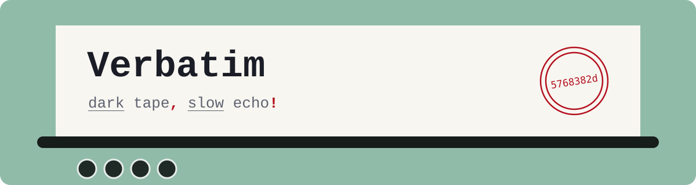
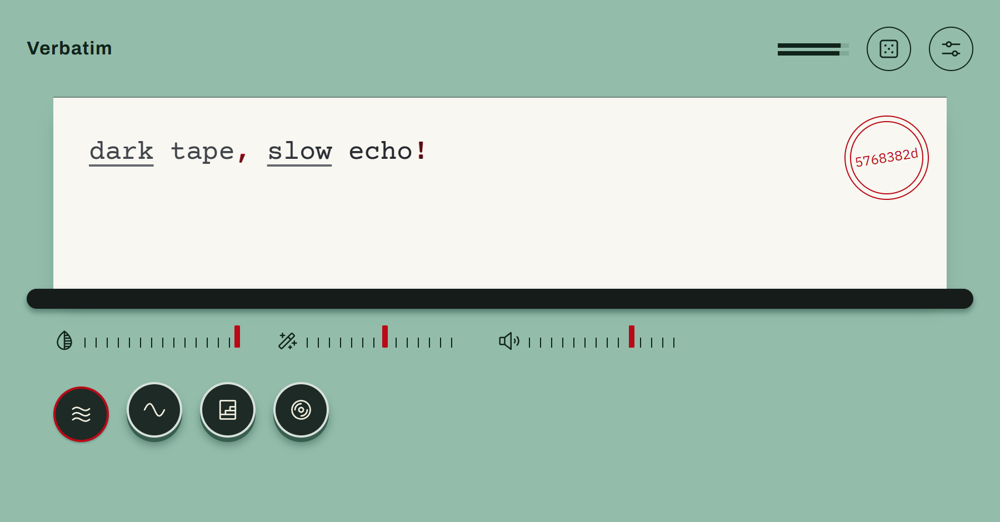

<picture>
  <source media="(prefers-color-scheme: dark)" srcset="docs/assets/banner-dark.svg">
  
</picture>


**Type a sentence. Hear an effects chain. The same text gives the same sound, bit for bit, forever.**

Verbatim is an audio effect plugin where the text you type *is* the patch. Every ordinary word rerolls a chain of
effects; direction words, punctuation, numbers and capitals push that chain around without rerolling it. Each line
is its own voice. Copy the text, paste it into another project, and you get the identical sound.

[See it](#see-it) · [What the text does](#what-the-text-does) · [Install](#install) · [Grammar cheat sheet](#grammar-cheat-sheet) ·
[How it works](#how-it-works) · [Built to be trusted](#built-to-be-trusted) · [Build from source](#build-from-source) · [Known limits](#known-limits)

---

## What it does

| Without Verbatim | With Verbatim |
|---|---|
| A new sound means scrolling presets or dialling twenty knobs | Type a word; the chain changes on the keystroke |
| "That sound from last week" lives in one project file | The text *is* the preset: paste it anywhere, hear it again |
| Randomise buttons give a different result every time | Same text, same chain, bit for bit, on every machine |
| Tweaking a favourite means losing it | Hold the effects you like; reroll everything else |

## See it



`dark tape, slow echo!` gives Reverb, Tremolo, Bitcrush and Tape wow. The underlined words (`dark`, `slow`) and the
red marks (`,` `!`) are controls: they darken the tone, slow the movement, duck the voice and drive its input. Only
`tape` and `echo` decide *which* effects you get, so `tape echo` alone gives the same four, undarkened. The key with the
red rim is held: it stays when you type something else.

## What the text does

| You type | You hear |
|---|---|
| an ordinary word | a new chain for that line (2 to 6 of 16 effects, with their settings) |
| `dark` `bright` `warm` `slow` `wide` `long` `deep` `loud` ... | the same chain, pushed in that direction |
| `! ? ~ , - + > / : & " .` and `...` | lane-level moves: drive, wander, wobble, duck, dry/wet, feedback, split, follow, chain, band, shorter or longer tails |
| a number like `8` | delays, tremolo and the main LFO lock to eighth notes at the host tempo |
| `50%` | the voice's wet level |
| `CAPS` | every effect in the line pushed wetter |
| a new line | a new voice, running in parallel (up to 4) |

## Install

1. Install the [Microsoft WebView2 runtime](https://developer.microsoft.com/microsoft-edge/webview2/) (already present on Windows 11).
2. Copy `Verbatim.vst3` into `C:\Program Files\Common Files\VST3\` (this needs administrator rights).
3. Rescan plugins in your DAW and insert **Verbatim** on an audio track.

A first-load Verbatim passes audio through untouched until you type.

## Using it

| Want to | Do |
|---|---|
| Hear something now | Type any word, or press the dice (**Roll**) for a random phrase |
| Keep an effect you like | Click its key: it latches down with a red rim and survives rerolls |
| Push the sound | Add direction words and punctuation; nothing rerolls |
| Fit it in the mix | **Mix**, **Macro** and **Output** on the ruler. Macro moves every effect at once and automates well |
| Fine-tune, add or remove | Open **Advanced** (sliders icon), click a key, edit its parameters; the **+** key adds an effect |
| Undo a roll | Ctrl+Z in the text |

Everything is reachable by keyboard and screen reader.

## Grammar cheat sheet

**Direction words** (each one step; repeats stack up to 3; they never reroll)

| Axis | Down | Up | Moves |
|---|---|---|---|
| Tone | `dark` | `bright` | filters, tilt, damping, pitch of combs and rings |
| Heat | `cold` | `warm` | drive, bit depth, compression |
| Rate | `slow` | `fast` | LFOs, delay times, modulation rates |
| Space | `narrow` | `wide` | stereo width, reverb width, grain spray |
| Tail | `short` | `long` | feedback, decay, release |
| Depth | `thin` | `deep` | every effect's wet mix |
| Level | `soft` | `loud` | the voice's level |

**Punctuation** (counted per line, up to 3)

| Mark | Does |
|---|---|
| `!` | drives the voice's input into a soft clipper |
| `?` | a slow random wander on one effect |
| `~` | more wobble from the main LFO |
| `,` | the voice ducks under the dry signal |
| `-` / `+` | drier / wetter, 15 % a step |
| `>` | feeds the voice's output back into itself |
| `/` | splits the chain into two parallel halves |
| `:` | an envelope follower modulates one effect |
| `&` | this line processes the previous line's output instead of the input |
| `"` | the voice works on a frequency band only |
| `.` / `...` | shorter / longer tails |

**Other rules**

- Numbers 1 to 64 set the time base (snapped to 1, 2, 3, 4, 6, 8, 12, 16, 24 or 32); `NN%` sets the voice's mix.
- Only the first four non-blank lines make sound; later lines are struck through.
- Emoji, accents and any script work as words. The text is limited to 4096 bytes.
- The full, normative grammar is [docs/04-seed-grammar.md](docs/04-seed-grammar.md).

## How it works

```
text ─ tokenizer ─┬─ ordinary words ─ XXH64 ─ lane seed ─ SplitMix64 ─ effects and settings
                  └─ modifiers ─ direction bias, lane fields
lanes ─ ChainSpec (integers only) ─ your holds and edits ─ DSP engine ─ crossfaded swap ─ audio
```

| Part | Path | What it is |
|---|---|---|
| core | [`core/`](core/) | Text to ChainSpec. Pure C++20, integer arithmetic only, no JUCE: the same bytes on every compiler and CPU |
| dsp | [`dsp/`](dsp/) | 16 effects, lane stages, modulation, and a lock-free engine that builds each new chain off the audio thread and crossfades it in |
| plugin | [`plugin/`](plugin/) | JUCE 8 VST3: host parameters, project state, the WebView2 editor and its bridge |
| gui | [`gui/`](gui/) | React + TypeScript + framer-motion, built into the plugin; no network at run time |
| tools | [`tools/`](tools/) | `vb_spec` prints any text's chain and hash; corpus and audit scripts |

The design documents behind every decision are in [`docs/`](docs/).

## Built to be trusted

| Promise | How it is checked |
|---|---|
| Same text, same chain, forever | 420 golden texts (every mark, word, script, invalid byte and edge case) hash identically on MSVC, clang-cl, Linux clang, Linux gcc and macOS clang; a CI guard blocks any change to the frozen hashes |
| Same session, same audio | Renders are bit-identical across fresh instances, `reset()`, project reload and two bounces from the same play start; output stays within -100 dBFS across host block sizes |
| Never harms your mix | 2000 random texts and 200 extreme cases (silence, DC, full-scale square, 44.1 to 192 kHz, 16 to 8192-sample blocks): no NaN, never above 0 dBFS, no self-oscillation |
| Real-time safe | Zero allocations on the audio thread through chain swaps and automation; a lock audit of every audio-thread function; RealtimeSanitizer in CI |
| Light on CPU | The worst case (4 voices x 8 effects including pitch, granular and reverb) runs at about 11x real time |
| A well-behaved plugin | pluginval at strictness 10 and Steinberg's VST3 validator (47/47) |
| A usable editor | 59 browser tests: input latency (p95 under 10 ms), core-exact token colouring, keyboard-only use, axe accessibility scan, reduced motion, screenshot baselines |

## Build from source

Requirements: Windows 10/11 x64, CMake 3.24+, Visual Studio 2022 or newer with the C++ workload, Node.js 20+ with npm.
CMake fetches JUCE 8.0.17, Catch2 and the WebView2 SDK at configure time.

```
cmake -S . -B build -A x64
cmake --build build --config Release
ctest --test-dir build -C Release
```

The plugin is written to `build/Verbatim_artefacts/Release/VST3/Verbatim.vst3`. The UI's browser tests run with
`npm run test:e2e` in `gui/` (`npx playwright test`, using the installed Chrome).

## Known limits

- Windows only, VST3 only. No MIDI or sidechain input; no per-effect host automation (Mix, Macro and Output are automatable).
- Text is hashed as raw UTF-8 bytes: a letter typed as one composed character and as a letter plus combining accent are different seeds.
- Effect tails are not carried across a reroll; a new chain fades in over about 30 ms after its delay lines fill.
- Bit-identical audio is promised for the same build on the same machine; across compilers or CPUs it is equal to within floating-point rounding, while the chain itself is identical everywhere.
- Opening the editor for the first time can stall the first keystroke or two while fonts and the web view warm up.

## License

[AGPL-3.0](LICENSE). Built with JUCE (AGPL-3.0), xxHash (BSD-2-Clause), Catch2 (BSL-1.0), the Microsoft WebView2 SDK
(BSD-3-Clause), Phosphor Icons (MIT) and the Courier Prime, Archivo and IBM Plex Mono typefaces (OFL-1.1).
